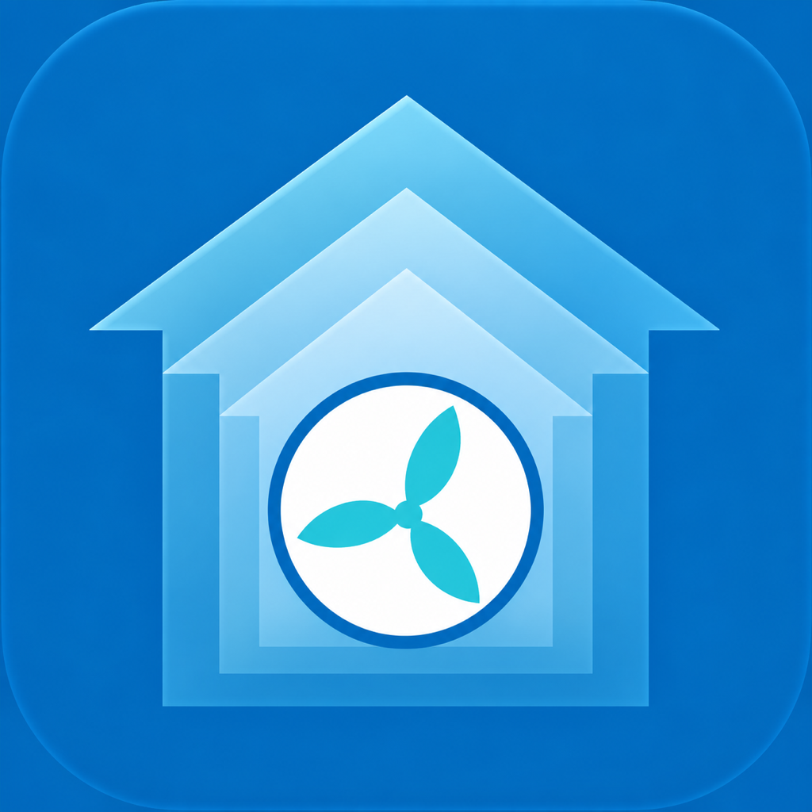

# SvaraHome for Homebridge



Give the fan a boost. Pause it for a quiet moment. Let it return to normal when the time is up.

SvaraHome brings local Bluetooth control for Pax Calima and Vent-Axia Svara fans into Apple Home through your Homebridge host. No SvaraHome cloud account is needed.

[Website and support](https://homebridge.svarahome.kernowekconsulting.co.uk) · [Plugin on npm](https://www.npmjs.com/package/homebridge-pax-calima) · [Release notes](RELEASE_NOTES.md)

**SvaraHome 2.5 is currently available on the beta channel.** Select `2.5.0-beta.3` in Homebridge’s version selector to use the controls described here. Full 2.5.0 has not been released.

## What you get in Apple Home

| Control | What it does |
| --- | --- |
| **Fan** | Shows measured speed as a percentage. Off starts a timed pause; On returns either Pause or Boost to automatic ventilation. |
| **Boost Fan** | Runs the fan at your chosen speed for a limited time. Turn it off to return sooner. Shown by default. |
| **Pause Fan** | Optional separate pause switch for status and automations. Hidden by default unless explicitly enabled. |
| **Silent Hours** | Optional switch for the fan’s saved quiet-hours schedule. It does not start an immediate pause. |

**Fan Off is a timed pause, not a permanent shutdown.** The default is 10 minutes; choose the duration in Plugin Config. The fan’s own timer resumes automatic ventilation even if Homebridge disconnects. Apple Home’s Off label does not show that timer.

Boost and Pause share one temporary override. Starting either replaces the other. Turning the main Fan on returns to automatic ventilation; automatic operation can still leave the motor idle under the fan’s own rules.

The displayed speed comes from measured RPM. It can differ from the requested percentage while the motor settles. The speed slider starts a temporary session using the Boost duration; it leaves persistent ventilation speed presets in place. A zero-speed request starts the timed pause. Low nonzero requests use the supported minimum of 1000 RPM.

Temperature, humidity and light are **not exposed as ambient sensors**. SvaraHome does not provide a shower-detection sensor or infer room conditions from fan speed.

## Use your own words

Assign each fan to its room in Apple Home. In a room named Kitchen, try:

- “Siri, turn on Boost Fan in the kitchen.”
- “Siri, turn off the kitchen fan.”
- “Siri, turn on the kitchen fan.”

Siri recognition depends on your actual accessory names and room assignments. Apple Home may retain a customised tile name; rename an existing control there if needed. You can also include the controls in your own scenes and automations.

Apple Home may show the controls together or as separate tiles, depending on its presentation settings. Homebridge’s Accessories page can also show child-bridge accessories when UI accessory control is available; check its bridge filter.

## Get started

You need Homebridge 1.8 or later within version 1, or Homebridge 2; Node 22.12 or later within Node 22, or Node 24; and a working Bluetooth adapter with the normal Bluetooth access for your Homebridge installation.

1. Install `homebridge-pax-calima` through Homebridge UI and select the 2.5 beta version.
2. Open Plugin Config. Add each fan’s Bluetooth address and its own six- or eight-digit PIN from the official app. Keep leading zeroes. There is no default PIN or automatic pairing with nearby fans.
3. Choose the Boost speed/duration and Pause duration. Close the official app while Homebridge connects.
4. Save and use **Restart Child Bridge** on SvaraHome’s plugin card. A dedicated child bridge is recommended; pair it with Apple Home if it is not already paired.
5. Assign each fan to its room in Apple Home and check its controls.

Temporary controls require a supported fan operating mode. SvaraHome does not change the fan’s installation mode. A factory reset or accessory-cache reset is not part of normal setup or upgrading.

If you manage plugins from a terminal, the current testing channel is `homebridge-pax-calima@beta`. Prefer Homebridge UI when it manages your installation.

## Configuration

```json
{
  "platform": "PaxCalima",
  "name": "SvaraHome",
  "fans": [
    {
      "name": "Kitchen Fan",
      "mac": "58:2b:db:12:34:56",
      "pin": "00123456"
    }
  ],
  "boostMinutes": 10,
  "boostRpm": 2000,
  "pauseMinutes": 10,
  "showBoostSwitch": true,
  "showPauseSwitch": false
}
```

The address and PIN are examples. Use your own fan’s details. A Bluetooth address prefix alone does not establish compatibility. Empty or unusable configuration does not start Bluetooth discovery.

| Setting | Purpose |
| --- | --- |
| `fans[].name` | Name for a newly added fan. Existing accessory identities and Home room assignments are retained. |
| `fans[].mac` / `fans[].pin` | Required address and PIN for that particular fan. |
| `boostMinutes` / `boostRpm` | Temporary Boost duration and requested speed. Defaults: 10 minutes and 2000 RPM. |
| `pauseMinutes` | Timed pause duration, including when the main Fan is turned off. Default: 10 minutes. |
| `showBoostSwitch` | Show Boost Fan. Default: `true`. |
| `showPauseSwitch` | Show the separate Pause Fan switch. Default: `false`; an explicitly enabled setting stays enabled. |
| `fans[].maxManualRpm` | Optional per-fan limit for Boost and slider requests. Leave blank for the 2500 RPM target limit, or use a lower speed confirmed to work on your fan. This does not cap displayed measurement or alter permanent presets. |
| `silentHoursStart` / `silentHoursEnd` | Optional saved quiet-hours schedule, in 24-hour format. Set both times, or leave both blank to retain the fan’s own schedule. |
| `showSilentSwitch` | Show the saved schedule’s enable/disable switch. Default: `false`. |

Boost and Pause durations accept 1–60 minutes. Boost speeds and per-fan target limits accept 1000–2500 RPM in steps of 25. Fans can differ in which targets they accept.

Changing quiet-hours times saves and checks the schedule once. Routine polling respects later schedule changes made in the official app. The Silent Hours switch enables or disables that saved schedule; use Fan Off for an immediate timed pause. Quiet-hours behaviour still depends on the fan’s firmware and settings.

Hiding an optional switch removes its service. Check scenes and automations that use it before changing visibility; hiding it does not cancel a running override.

## If a fan is unavailable

Check its address and PIN privately in Plugin Config, Bluetooth range/adapter access, and whether the official app is still connected. Start with the Homebridge log’s fan-specific message; do not reset the accessory cache or power-cycle the Pi as a routine first step.

Temporary connection failures leave the newest manual request waiting for retry. A waiting request can start later when the fan reconnects. Turn the main Fan on to replace it with return-to-automatic. Siri may time out before recovery; that timeout does not cancel the waiting request.

Tiles follow confirmed fan state. Background readings are retained only within a 45-second freshness limit; failed commands, stale data and invalid readings report communication faults. A rejected PIN stops unattended authentication retries: correct the saved details, restart the child bridge, then try again.

## Upgrading to 2.5

Keep the existing fan accessory and its room assignment. Check each fan’s address/PIN and any scenes that used the previous Boost event service. Boost is now an actionable **Boost Fan** switch; **Pause Fan** is optional. Unsupported temperature, humidity and light services are removed, and the speed slider now controls a temporary session.

An explicitly enabled Pause switch remains enabled after upgrading. Turn off **Show Pause Fan in Apple Home** if you prefer only Fan and Boost Fan. No re-pairing is normally required.

## About the project

SvaraHome is independent of Apple, Homebridge, Pax and Vent-Axia. **Homebridge verification has not yet been granted.** Homebridge controls the verification badge and central plugin icon; bundling the SvaraHome artwork does not grant either.

For help, start with the [SvaraHome website](https://homebridge.svarahome.kernowekconsulting.co.uk) or [GitHub issues](https://github.com/KernowekConsulting/homebridge-pax-calima/issues). [Validation evidence](docs/VALIDATION.md) and [verification preparation](docs/VERIFICATION.md) are available separately.
